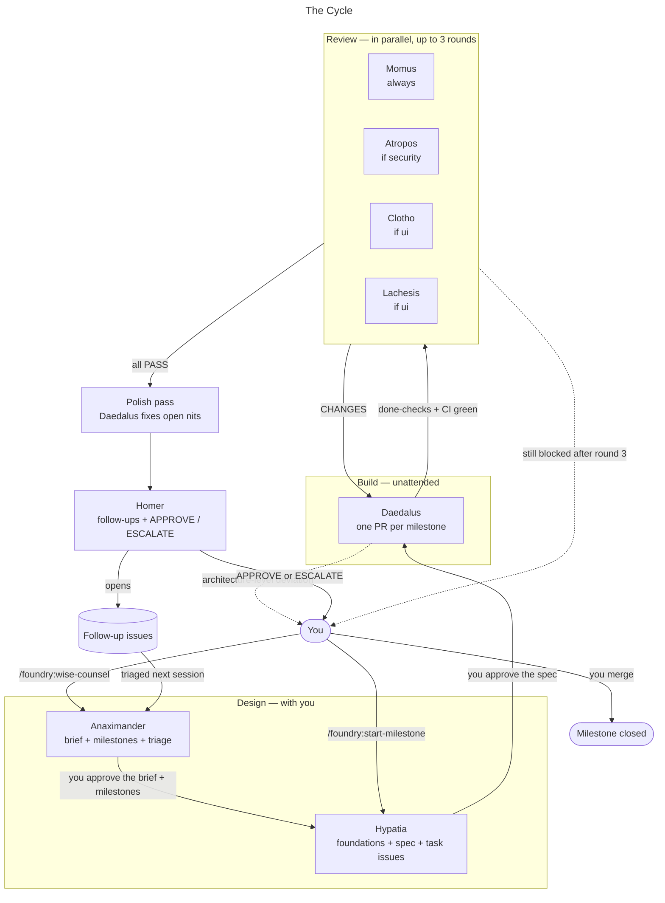

# Foundry

A software factory built with Claude Code and GitHub in mind.

Foundry is a Claude Code plugin. You shape **what** gets built and decide
**architecture**; the factory builds, verifies and reviews unattended, and hands
you a pull request with a verdict. You always merge.

See the [workflows design](docs/superpowers/specs/2026-11-23-foundry-workflows-design.md) for the full detail.

## Commands

| Command | What it does |
| ------- | ------------ |
| `/foundry:wise-counsel` | Summon Anaximander for a product design interview. Triages open follow-ups, creates or revises the product brief and the roadmap of GitHub Milestones. Run it once in every repo before the first milestone. |
| `/foundry:start-milestone [NN]` | Hand a milestone to Hypatia and run the cycle. With no argument, takes the lowest-numbered open Milestone. Re-run on the milestone in flight to resume it. |

## Map of the Foundry

The plugin:

```
.claude-plugin/plugin.json
skills/                                 run in your session, so they can talk to you
  wise-counsel/SKILL.md       Anaximander: product brief, core experiences, roadmap, triage
  start-milestone/SKILL.md    Hypatia: technical foundations, spec, task issues
  factory/
    SKILL.md                  the orchestrator: sequencing, review routing, escalation, resume
    contract.md               shared names and formats every hero uses
    templates/                product brief, architecture, spec, build log
      github/                 milestone, PR, review, approval, escalation, task and follow-up issues, docs PR
agents/                                 run unattended, dispatched by the factory
  builder.md                  opus      code, commits, the PR, build.md
  reviewer-code.md            routed    correctness, simplicity, tests, definitions of done
  reviewer-security.md        opus      only when `security` is flagged
  reviewer-ux.md              sonnet    only when `ui` is flagged
  reviewer-ui.md              haiku     only when `ui` is flagged
  approver.md                 opus      APPROVE or ESCALATE, opens follow-up issues
```

What it keeps in your repo (content only; nothing here records status):

```
docs/
  product.md                          vision, product constraints, core experiences, decision log
  architecture.md                     stack, testing, CI, CD, conventions (every entry your decision)
  specs/<date>-NN-<slug>.md           technical design, decisions, definitions of done, task links
  builds/<date>-NN-<slug>.md          what was built, deviations, known issues, review rounds
```

What it keeps on GitHub (the source of truth for state):

- **Milestones** titled `NN · <name>`: goals, scope, acceptance criteria, flags, the experiences they serve. Closed means shipped.
- **Task issues** titled `NN.T · <task>`, closed by the milestone's PR.
- **Follow-up issues** labelled `foundry:follow-up`, waiting for triage.
- **PRs**, one per milestone, labelled with the run's stage.

## Our Heroes

| Name | Agent | Role |
| ---- | ----- | ---- |
| Anaximander, High Sage (`skills/wise-counsel`) | Session model (use Opus) | Product designer. Interviews you about a new product or feature: its vision, product constraints and three to five core experiences, failure moments included. Then proposes milestones as GitHub Milestones. On later visits, triages open follow-ups with you and revises the brief and roadmap in light of what was actually built. Closed milestones are history; he never rewrites them. |
| Lady Hypatia (`skills/start-milestone`) | Session model (use Opus) | Technical designer. Sets the project's technical foundations with you (stack, testing, CI, CD) in `docs/architecture.md`, then turns one milestone into a spec and one issue per task, with definitions of done for every acceptance criterion and failure moment. Asks you about every real architecture choice. You approve her spec before anything is built. |
| Daedalus, Master Craftsman (`builder.md`) | Opus | Builder. Works through the task issues unattended, one PR per milestone, and keeps `build.md`. Fixes every blocking finding and every nit. Small surprises he decides and records; architecture-level ones he brings to you. The PR leaves draft only when every done-check and CI pass. |
| Momus, the Faultfinder (`reviewer-code.md`) | Sonnet, or Opus for large, core or flagged PRs | Correctness, simplicity, tests, the architecture's conventions, and whether every definition of done is covered. Reviews every PR. |
| Atropos, the Inflexible (`reviewer-security.md`) | Opus | Security. Only when the milestone is flagged `security`. |
| Clotho, the Spinner (`reviewer-ux.md`) | Sonnet | Behaviour and flow: can someone actually get this done? Walks each core experience's journey and failure moments; states, copy, keyboard and screen-reader use. Only when flagged `ui`. |
| Lachesis, the Alloter (`reviewer-ui.md`) | Haiku | Visual conformance: does this look like it belongs? Tokens, spacing, breakpoints, contrast. Only when flagged `ui`. |
| Homer, Scribe of Ages (`approver.md`) | Opus | Judges the whole milestone against its goals, experiences and acceptance criteria, checks no nit was left open, opens follow-up issues for anything out of scope, then reports APPROVE or ESCALATE on the PR. |

## The Cycle



The factory never merges and never tags a release. Whenever an agent needs you, the question comes to
you in your session and is also recorded on the PR, so a run can be resumed
from where it stopped.
