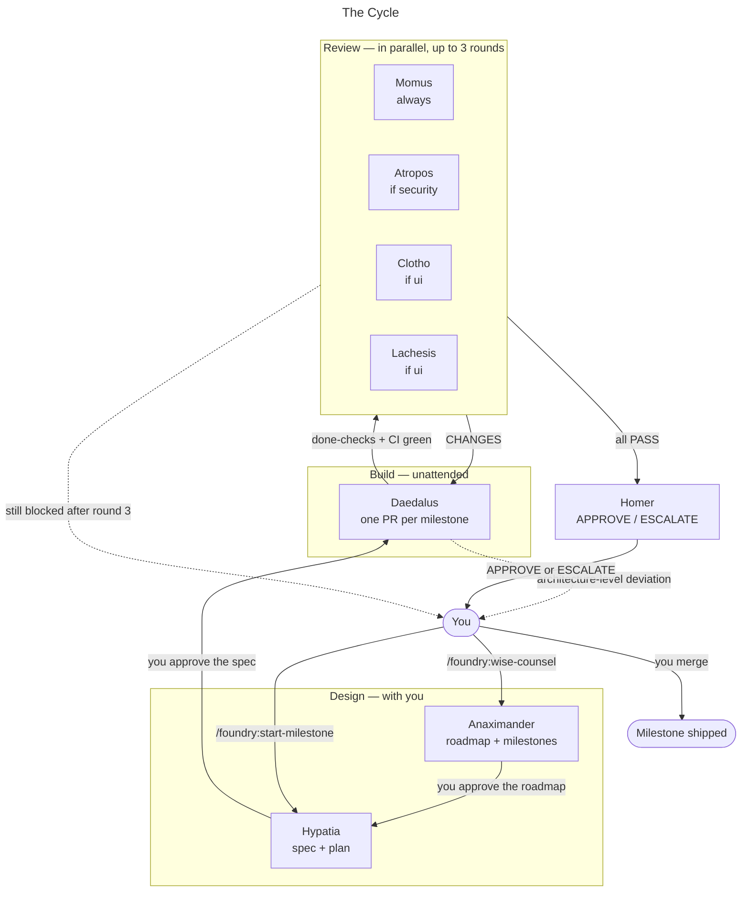

# Foundry

A software factory built with Claude Code and GitHub in mind.

Foundry is a Claude Code plugin. You shape **what** gets built and decide
**architecture**; the factory builds, verifies and reviews unattended, and hands
you a pull request with a verdict. You always merge.

See the [workflows design](docs/superpowers/specs/2026-11-23-foundry-workflows-design.md) for the full detail.

## Commands

| Command | What it does |
| ------- | ------------ |
| `/foundry:wise-counsel` | Summon Anaximander for a product design interview. Creates or revises the roadmap and its milestones. |
| `/foundry:start-milestone [milestone]` | Hand a milestone to Hypatia and run the cycle. With no argument, takes the next planned milestone. Re-run on an in-progress milestone to resume it. |

## Map of the Foundry

The plugin:

```
.claude-plugin/plugin.json
commands/
  wise-counsel.md             → Anaximander
  start-milestone.md          → Hypatia, then the factory
skills/factory/SKILL.md       the orchestrator: sequencing, review routing, escalation, resume
agents/
  designer.md                 opus      product design interview, owns the roadmap
  spec-writer.md              opus      technical design, architecture decisions, task plan
  builder.md                  opus      code, commits, the PR, build.md
  reviewer-code.md            routed    correctness, simplicity, tests, definitions of done
  reviewer-security.md        opus      only when `security` is flagged
  reviewer-ux.md              sonnet    only when `ui` is flagged
  reviewer-ui.md              haiku     only when `ui` is flagged
  approver.md                 opus      APPROVE or ESCALATE, keeps the record
```

What it writes into your repo (files are the source of truth; GitHub Milestones mirror them):

```
docs/
  roadmap.md                          the roadmap and its history
  milestones/NN-<slug>.md             goals, scope, acceptance criteria, flags
  specs/<date>-<milestone>.md         technical design, decisions, task plan, definitions of done
  builds/<date>-<milestone>.md        what was built, deviations, review rounds
```

## Our Heroes

| Name | Agent | Role |
| ---- | ----- | ---- |
| Anaximander, High Sage (`designer.md`) | Opus | Product designer. Interviews you about a new product or feature and writes the roadmap and its milestones. On later visits, revises the roadmap in light of what was actually built. Shipped milestones are history; he never rewrites them. |
| Lady Hypatia (`spec-writer.md`) | Opus | Technical designer. Turns one milestone into a spec: technical design, architecture decisions, a task-by-task plan, and precise definitions of done. Asks you about every real architecture choice. You approve her spec before anything is built. |
| Daedalus, Master Craftsman (`builder.md`) | Opus | Builder. Works through the plan unattended, one PR per milestone, and keeps `build.md`. Small surprises he decides and records; architecture-level ones he brings to you. The PR leaves draft only when every done-check and CI pass. |
| Momus, the Faultfinder (`reviewer-code.md`) | Sonnet, or Opus for large, core or flagged PRs | Correctness, simplicity, tests, and whether every definition of done is covered. Reviews every PR. |
| Atropos, the Inflexible (`reviewer-security.md`) | Opus | Security. Only when the milestone is flagged `security`. |
| Clotho, the Spinner (`reviewer-ux.md`) | Sonnet | Behaviour and flow: can someone actually get this done? States, copy, keyboard and screen-reader use. Only when flagged `ui`. |
| Lachesis, the Alloter (`reviewer-ui.md`) | Haiku | Visual conformance: does this look like it belongs? Tokens, spacing, breakpoints, contrast. Only when flagged `ui`. |
| Homer, Scribe of Ages (`approver.md`) | Opus | Judges the whole milestone against its goals and acceptance criteria, then reports APPROVE or ESCALATE on the PR. Records the milestone as shipped. |

## The Cycle



The factory never merges. Whenever an agent needs you, the question comes to
you in your session and is also recorded on the PR, so a run can be resumed
from where it stopped.
